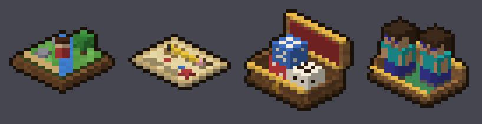

<div align="center">

# 🎲 DND

**Uma mesa de RPG completa dentro do Minecraft.**
Tabuleiro 3D, miniaturas com skin própria, dados, fichas de personagem — tudo para usar com seus amigos, no servidor ou no mundo.




</div>

---

## ✨ O que tem no mod

| Item | O que faz |
|---|---|
| 🗺️ **Tabuleiro de RPG** | Bloco onde você monta o mapa (terreno, altura, objetos) e move miniaturas, numa visão 3D orbital. |
| 🧙 **Caixa de Miniaturas** | Guarda quantas miniaturas quiser, organizadas em **abas**. Cada mini tem a sua própria skin. |
| 🎲 **Caixa de Dados** | d4, d6, d8, d10, d12, d20 e d100. A rolagem é feita no servidor e o resultado aparece no chat para todos. |
| 📜 **Ficha de Personagem** | Ficha editável em pergaminho (atributos, vida, CA, deslocamento, anotações). |
| 🧍 **Miniatura** | Uma mini solta, tirada da caixa, para colocar direto no mundo. |

---

## 🧰 Receitas

| Item | Receita (sem forma) |
|---|---|
| Caixa de Dados | Baú + Couro + Papel |
| Caixa de Miniaturas | Baú + Suporte de armadura + Papel |
| Ficha de Personagem | Papel + Saco de tinta + Pena |
| Tabuleiro de RPG | `L L L` de **lã verde** em cima de `T T T` de **tábua de carvalho escuro** (receita com forma) |

Todos aparecem também na aba **Blocos funcionais** do modo criativo.

---

## 🕹️ Como usar

### 🗺️ Tabuleiro
- Clique com o botão direito no tabuleiro para abrir a visão 3D.
- Aba **Minis**: botão esquerdo coloca ou arrasta uma miniatura, **R** gira a que está sob o mouse, botão direito remove.
- Aba **Mapa**: botão esquerdo (ou arrastar) pinta com a ferramenta escolhida — terreno, altura e objetos.
- Botão direito arrastando orbita a câmera; a roda do mouse dá zoom.
- Para levar suas miniaturas ao tabuleiro, clique nele com a **Caixa de Miniaturas** na mão. As **8 primeiras minis da aba ativa** são acopladas.

### 🧙 Caixa de Miniaturas
- **Sem limite de minis.** O conteúdo fica salvo no servidor (pasta `dnd_boxes` do mundo), não dentro do item, então a caixa não pesa no inventário.
- **Abas** para organizar (grupos, encontros, campanhas): criar, renomear e excluir. Ao excluir uma aba, as minis vão para a primeira.
- **Arraste um `.png` de skin (64×64)** para a janela para adicionar uma mini com skin própria na aba aberta.
- Em cada mini: renomear, alternar braço largo/fino, **mover para outra aba**, **tirar da caixa** (vira um item) ou apagar.
- 8 minis por página; use as setas ou a roda do mouse para trocar de página.
- Guardar rápido: com uma **miniatura no cursor**, clique com o botão direito na caixa (no inventário), ou clique com ela na mão numa miniatura/caixa colocada no mundo.
- Caixas de versões antigas são migradas automaticamente para a aba "Geral".

### 🎲 Caixa de Dados
- Escolha a quantidade de cada dado (até 20 por tipo, 50 por rolagem).
- Escolha uma **ficha de personagem do inventário** e um atributo (FOR, DES, CON, INT, SAB, CAR): o modificador `(valor − 10) / 2`, arredondado para baixo, é somado sozinho.
- Rolar sem ficha também funciona.

> **Nota:** a ficha ainda não tem proficiência nem perícias; só o modificador do atributo entra na conta.

### 📜 Ficha de Personagem
- Botão direito para abrir. Fechar com **Esc** ou **Salvar** grava; **Cancelar** descarta.
- O nome do personagem aparece no nome do item, para diferenciar várias fichas.

---

## 🪑 Itens na mesa

Você pode **pousar** a Caixa de Dados, a Caixa de Miniaturas e a Ficha em cima de qualquer bloco (inclusive o tabuleiro):

1. Segure o item, **agache** e clique com o botão direito na **parte de cima** de um bloco.
2. Eles são pequenos e ficam no ponto exato do clique, então cabem **vários no mesmo bloco**, inclusive nos cantinhos. A ficha fica deitada sobre a mesa.

Depois de pousados, continuam **totalmente funcionais**, sem precisar estar no inventário:

| Ação | Resultado |
|---|---|
| Botão direito | Usa o item (rola dados, abre a caixa, abre a ficha). |
| Botão direito com uma miniatura na mão, numa caixa | Guarda a miniatura na caixa. |
| Agachado + botão direito | Pega o item de volta. |
| Bater | Quebra e solta o item. |

---

## 🔧 Compilar

Requer **Java 25**. O Gradle Wrapper baixa a distribuição do Gradle sozinho, se precisar.

```bash
./gradlew build          # Linux / macOS
gradlew.bat build        # Windows
```

O `.jar` sai em `build/libs/`. Para testar no jogo: `./gradlew runClient`.

**Dependências:** Minecraft `26.2`, Fabric Loader `>= 0.20.1`, Fabric API.

---

## 🗂️ Estrutura

```
src/main/java/com/example/dnd/
├── block/      tabuleiro, suporte de miniatura, dados da mini
├── box/        armazenamento das caixas no servidor (abas)
├── entity/     miniatura em pé e itens pousados na mesa
├── item/       caixa de dados, caixa de minis, ficha, miniatura
├── network/    pacotes cliente <-> servidor
└── sheet/      dados e registro da ficha de personagem
src/client/java/com/example/dnd/client/
├── telas       tabuleiro, caixa de minis, dados, ficha
└── render/     renderers (miniaturas, itens na mesa, bandeja 3D)
tools/          scripts Python que geram texturas e arte dos itens
```

---

## 📄 Licença

[CC0-1.0](LICENSE): domínio público. Use, modifique e distribua à vontade.
